# Journal

In this journal I try to write, visualize and summarize my interim findings during the project.

**Last updated:** 22 nov 2026  
**Author:** Jonathan Brahim 

## Phase 1 - PBQC Simulation Pipeline 

**Main goal**: Built a Python pipeline to explore PBQC for various quantum circuits. 

The main simulation takes place in [`simualation.py`](phase1/simulation.py).

**Graph creation and convert into quantum circuit**
The pipeline converts weighted graphs into quantum circuits. Each graph node maps to one qubit. Edges encode entanglement structure: an edge (u, v) with weight w becomes an RZZ(w) (at this stage just ZZ-rotation gates, exc. H-gates) gate on qubits u and v. See [`create_graphs.py`](phase1/create_graphs.py) and [`graph_to_circuit.py`](phase1/graph_to_circuit.py).

As shown in Fig. 1 and 2 below one can create for example a K3 graph where all the weights are the same and one where (one or more) weights differ. T

  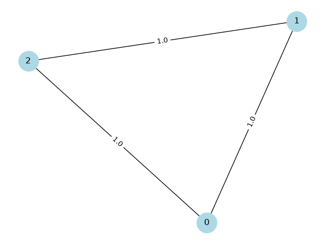
  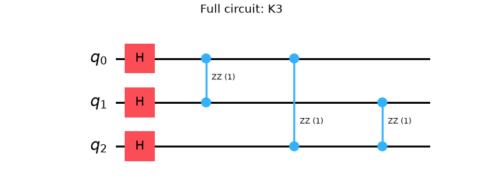
     
  <em>Fig. 1. (a.) K3-graph with all the same weights, (b.) converted into a circuit .</em>

  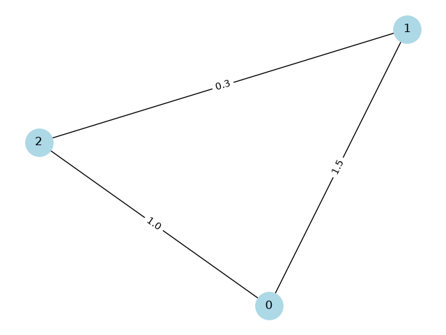
  
     
  <em>Fig. 2. (a.) Similar K3-graph with differing weights, (b.) converted into a circuit .</em>

**Quantum (sub)circuit transpiled into brickwork graph.**

The pipeline continues by taking different (sub)circuits (can also be the full circuit) to transpile into a brickwork graph using MasonQ. As shown in Fig. 3 and 4 one can choose certain gates (one can now freely choose which ones) to convert into brickwork graphs. >  See [`circuit_to_brickwork.py`](phase1/circuit_to_brickwork.py).

  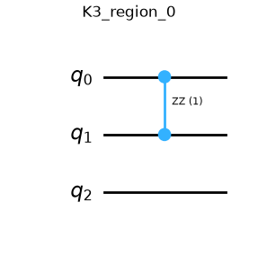
  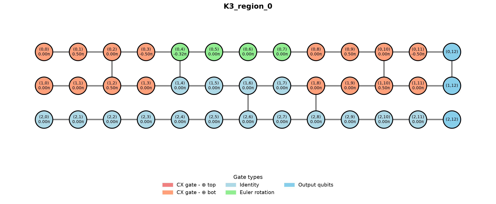
  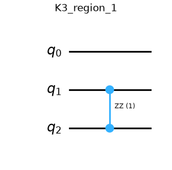
  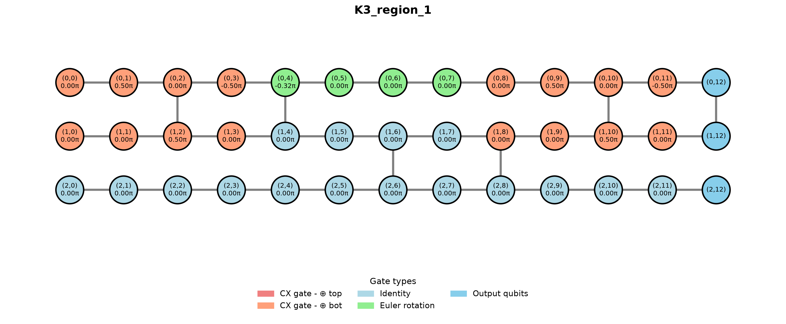
    
  <em>Fig. 3. Two gates (subcircuits) from K3-graph from Fig. 1 | (a.) and (c.) both converted into brickwork graphs; respectively (b.) and (d.)  </em>

  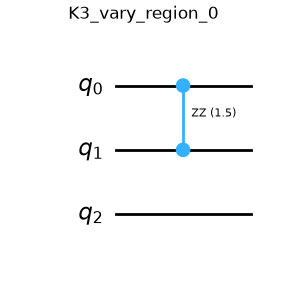
  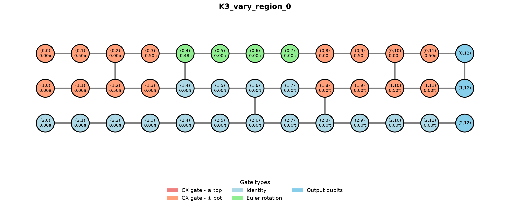
  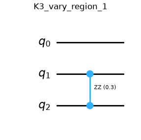
  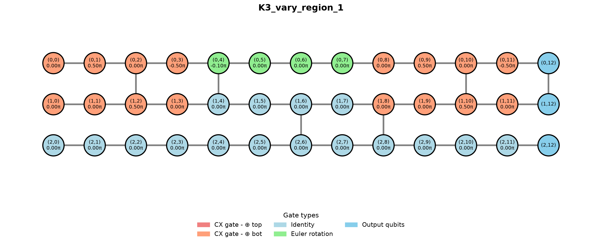
    
  <em>Fig. 4. Two gates (subcircuits) from different weighted K3-graph from Fig. 2 | (a.) and (c.) both converted into brickwork graphs; respectively (b.) and (d.)  </em>

Finally a list of most resources is printed and saved for comparison. The result here show the Table below.

| name | graph_nodes | graph_depth | brick_rows | brick_cols | qiskit_depth | qiskit_gates | cx_gates |
| --- | --- | --- | --- | --- | --- | --- | --- |
| custom_full | 207 | 69 | 3 | 17 | 19 | 27 | 9 |
| K3_region_0 | 39 | 13 | 3 | 3 | 3 | 3 | 2 |
| K3_region_1 | 39 | 13 | 3 | 3 | 3 | 3 | 2 |
| K3_vary_region_0 | 39 | 13 | 3 | 3 | 3 | 3 | 2 |
| K3_vary_region_1 | 39 | 13 | 3 | 3 | 3 | 3 | 2 |

Observation: having the same quantum circuit structure with same selected converted gates but different weights as rotation does not change the amount of resources in a brickwork graph.